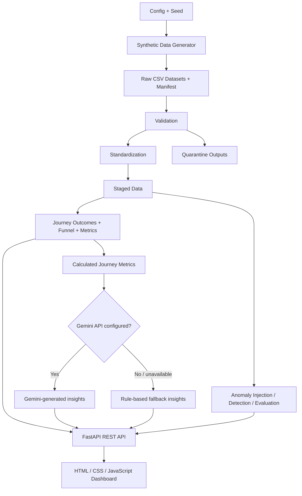

<div align="center">

# Customer Journey Analytics Platform

**Turn synthetic customer events into funnel analytics, anomaly evaluations, and AI-assisted recommendations.**

[](https://www.python.org/)
[](https://fastapi.tiangolo.com/)
[](https://ai.google.dev/)
[](https://pandas.pydata.org/)
[](https://pytest.org/)

[**Live Dashboard**](https://deepesh-agrawal1.github.io/customer-journey-pipeline/) ·
[**GitHub Repository**](https://github.com/deepesh-agrawal1/customer-journey-pipeline) ·
[**Portfolio**](https://deepesh.codes)

</div>

---

## Overview

Customer Journey Analytics Platform is a synthetic-data analytics project for exploring how users move through digital journeys, where they drop off, and which patterns deserve further investigation.

It combines a reproducible Python data generator, a validation and standardization pipeline, CSV-based analytical datasets, a FastAPI backend, an interactive JavaScript dashboard, anomaly-analysis workflows, and optional Google Gemini-powered insights.

The project is intended for engineering demonstrations, data-pipeline testing, analytics prototyping, and experimentation with data quality and anomaly evaluation. **All generated journey data is synthetic; the metrics are not real business performance.**

## Current Dataset Snapshot

Latest successful local generation reported by the pipeline:

| Dataset / metric | Result |
|---|---:|
| Customers | 5,000 |
| Sessions | 10,000 |
| Journey events | 200,000 |
| Journey outcomes | 10,000 |
| Pages | 6 |
| Products | 20 |
| Validated events | 200,000 |
| Quarantined events | 0 |

These numbers describe one configured run. They will change when `config/config.json` changes.

## Features

### Journey analytics
- Funnel stages: browse, product interest, cart intent, and purchase.
- Session outcome classification and conversion metrics.
- Device-level conversion comparisons.
- Page and product engagement summaries.
- Daily, weekly, and monthly session trends.
- Session explorer with filters and per-session event timelines.

### Data engineering
- Seeded synthetic data generation for reproducible runs.
- Consistent customer, session, event, page, product, and outcome identifiers.
- Schema, identifier, reference, and timestamp validation.
- Standardization before downstream analysis.
- Separation of valid/staged records and quarantined invalid records.
- Run manifest containing generation settings and record counts.

### Anomaly analysis
- Separate anomaly-injection and detection workflow.
- Detected anomaly output and evaluation against generated ground truth.
- Precision, recall, and F1-score reporting.
- API endpoints to inspect anomalies and trigger an analysis run.

### Gemini-powered insights
- Optional integration with the Google Gemini API.
- Supplies calculated journey metrics to the model and requests structured findings, supporting evidence, and recommended next steps.
- Uses cautious prompting: possible causes should be treated as hypotheses, not proven facts.
- Falls back to rule-based insights when the API key is missing or Gemini is unavailable or returns an unusable response.

> **AI scope:** Gemini generates explanations from calculated metrics. This project should not be described as a RAG system: the current implementation does not retrieve document chunks from a vector database.

## Architecture



## Technology Stack

| Layer | Technologies |
|---|---|
| Language | Python |
| API | FastAPI, Uvicorn |
| Data processing | Pandas, NumPy |
| AI insights | Google Gemini API via `google-genai` |
| Configuration | JSON, environment variables, `python-dotenv` |
| Storage | CSV files and JSON run manifest |
| Dashboard | HTML, CSS, JavaScript, Chart.js |
| Testing | pytest |
| Frontend hosting | GitHub Pages |
| Backend deployment | Render configuration in the repository |

## Repository Structure

```text
customer-journey-pipeline/
├── config/
│   └── config.json
├── data/
│   ├── raw/                 # Generated input datasets and manifest
│   ├── staged/              # Validated and standardized datasets
│   ├── curated/             # Outcomes, funnel, and journey metrics
│   ├── quarantine/          # Invalid records
│   └── anomalies/           # Detection and evaluation outputs
├── docs/                    # Project documentation
├── frontend/
│   ├── index.html
│   ├── style.css
│   └── app.js
├── src/
│   ├── api.py
│   ├── api_helpers.py
│   ├── generator.py
│   ├── validator.py
│   ├── standardizer.py
│   ├── pipeline.py
│   ├── analytics.py
│   ├── metrics.py
│   ├── funnel_analysis.py
│   ├── ai_insights.py
│   ├── anomaly_injection.py
│   ├── anomaly_detection.py
│   ├── anomaly_evaluation.py
│   └── routers/
├── tests/
├── main.py
├── requirements.txt
└── README.md
```

The tree highlights the main components; minor files and generated data may vary by branch and local run. Generated datasets may be ignored by Git and therefore may not be present in a fresh clone.

## Getting Started

### Prerequisites

- Python 3.10 or later
- Git
- A modern browser
- Optional: a Google Gemini API key for AI-generated insights

### 1. Clone the repository

```bash
git clone https://github.com/deepesh-agrawal1/customer-journey-pipeline.git
cd customer-journey-pipeline
```

### 2. Create and activate a virtual environment

**Windows (Command Prompt):**

```cmd
python -m venv .venv
.venv\Scripts\activate
```

**macOS / Linux:**

```bash
python3 -m venv .venv
source .venv/bin/activate
```

### 3. Install dependencies

```bash
python -m pip install --upgrade pip
python -m pip install -r requirements.txt
```

### 4. Configure data generation

Edit `config/config.json`. Example:

```json
{
  "seed": 20261022,
  "year": 2026,
  "customer_count": 5000,
  "session_count": 10000,
  "target_event_count": 200000,
  "domain": "generic_digital_journey",
  "storage_format": "csv",
  "timezone": "UTC",
  "session_timeout_minutes": 30
}
```

`target_event_count` requests an exact event count when supported by the current generator. Each session requires at least one event, so keep the target at or above `session_count`.

### 5. Generate, validate, and analyze the data

Run from the repository root:

```bash
python main.py
```

The pipeline writes raw CSV files and a manifest, runs validation and standardization, derives outcomes, and writes curated funnel and metrics files.

Typical output locations:

- `data/raw/` — generated input datasets and `manifest.json`
- `data/staged/` — validated and standardized data
- `data/curated/` — journey outcomes, funnel, and metrics
- `data/quarantine/` — rejected records
- `data/anomalies/` — anomaly detection and evaluation outputs after running anomaly analysis

### 6. Start the API

```bash
python -m uvicorn src.api:app --reload
```

- API base URL: `http://127.0.0.1:8000`
- Interactive documentation: `http://127.0.0.1:8000/docs`

The API expects the required processed CSV datasets to exist. Generate the data first if they are not available locally.

### 7. Start the dashboard

In a second terminal, run:

```bash
python -m http.server 5500 --directory frontend
```

Open `http://127.0.0.1:5500`.

For local development, `frontend/app.js` should use:

```javascript
const API_BASE_URL = "http://127.0.0.1:8000";
```

The repository also contains a Render API URL as a commented configuration option. Select the correct API URL for the environment you are using. The backend CORS configuration must allow the frontend origin.

## Gemini Configuration

AI insights are optional. Without a Gemini key, the endpoint returns rule-based fallback insights.

1. Create a Gemini API key through [Google AI Studio](https://aistudio.google.com/apikey).
2. Create a `.env` file in the repository root.
3. Add:

```dotenv
GEMINI_API_KEY=your_gemini_api_key
GEMINI_MODEL=gemini-2.5-flash
```

`GEMINI_MODEL` is optional; the current implementation defaults to `gemini-2.5-flash`.

Keep `.env` out of version control. **Never commit API keys to GitHub.** If a key has been committed accidentally, revoke it and create a replacement.

### How AI insights work

1. The application loads the available session, event, and outcome datasets.
2. It calculates aggregate metrics and funnel/device summaries.
3. The Gemini prompt receives those calculated metrics, not an unrestricted request to invent business data.
4. Gemini is asked for JSON insights with a title, finding, evidence, recommendation, and priority.
5. If Gemini is not configured or the call/response fails validation, rule-based insights are returned instead.

AI-generated recommendations are investigative suggestions, not proof of the cause of a drop-off.

## API Reference

Start the API and visit `/docs` for the live OpenAPI specification. The primary endpoints include:

| Method | Endpoint | Purpose |
|---|---|---|
| `GET` | `/api/health` | API health check |
| `GET` | `/api/metrics` | Overall journey KPIs |
| `GET` | `/api/funnel` | Funnel stage analysis |
| `GET` | `/api/quality` | Data quality summary |
| `GET` | `/api/outcomes` | Journey outcome distribution |
| `GET` | `/api/devices` | Device-level conversion |
| `GET` | `/api/performance` | Page and product performance |
| `GET` | `/api/trends?interval=day` | Time-based analytics (`day`, `week`, or `month`) |
| `GET` | `/api/sessions` | Search and filter sessions |
| `GET` | `/api/sessions/{session_id}/events` | Event timeline for a session |
| `GET` | `/api/insights` | Gemini-generated or fallback insights |
| `GET` | `/api/anomalies` | List/filter detected anomalies |
| `GET` | `/api/anomalies/metrics` | Anomaly evaluation metrics |
| `POST` | `/api/anomalies/run` | Run anomaly injection, detection, and evaluation |

Example requests:

```bash
curl http://127.0.0.1:8000/api/metrics
curl http://127.0.0.1:8000/api/insights
curl "http://127.0.0.1:8000/api/anomalies?limit=20"
```

Run anomaly analysis explicitly through the API:

```bash
curl -X POST http://127.0.0.1:8000/api/anomalies/run
```

## Testing

Run the test suite from the repository root:

```bash
python -m pytest -q
```

Tests should be run after changes to generation rules, validation, outcome logic, or anomaly detection. Do not rely on a successful data-generation run alone as proof that every analytical edge case is correct.

## Reproducibility and Data Quality

- Keep the configured seed fixed to reproduce a comparable synthetic run.
- Retain `data/raw/manifest.json` with the output datasets.
- Validate records before using them for analytics.
- Inspect quarantine outputs when validation rejects records.
- Evaluate anomaly detection against ground-truth labels, while keeping those labels out of the detector's input features.
- Treat generated metrics as test data, not production customer intelligence.

## Current Limitations

- Storage is CSV-based; a production database is not currently the primary storage layer.
- AI insights depend on an external Gemini API key and network availability; rule-based fallback is provided.
- AI output is generated from aggregate metrics and is not a retrieval-augmented generation (RAG) pipeline.
- The current synthetic generator and validation rules should be extended before claiming realistic multi-channel behavior, consent-aware identity resolution, ingestion-versus-occurrence ordering, or all planned edge cases.
- A hosted static dashboard requires a reachable API with a matching base URL and CORS configuration.

## Roadmap

- [ ] Expand to 100,000 sessions and approximately 2 million events.
- [ ] Add and validate richer web, app, and support-channel journeys.
- [ ] Model event occurrence time separately from ingestion time.
- [ ] Add explicit, consent-aware identity-link scenarios.
- [ ] Expand ground-truth edge cases, including duplicate purchases, bot traffic, and incorrect identity merges.
- [ ] Add cohort and segment analysis.
- [ ] Improve operational monitoring and deployment automation.
- [ ] Consider database-backed storage and batch processing for larger datasets.

## Contributing

1. Fork the repository.
2. Create a feature branch.
3. Make a focused change.
4. Run `python -m pytest -q`.
5. Open a pull request with a summary and test results.


## Author

**Deepesh Agrawal**

- GitHub: [@deepesh-agrawal1](https://github.com/deepesh-agrawal1)
- Portfolio: [deepesh.codes](https://deepesh.codes)
